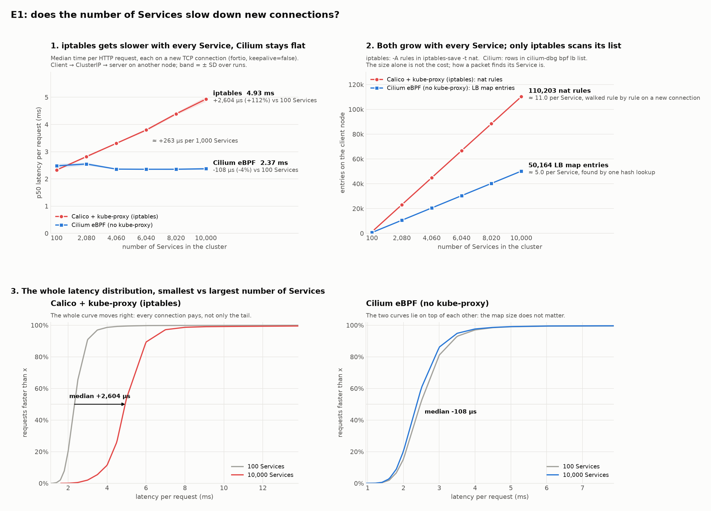
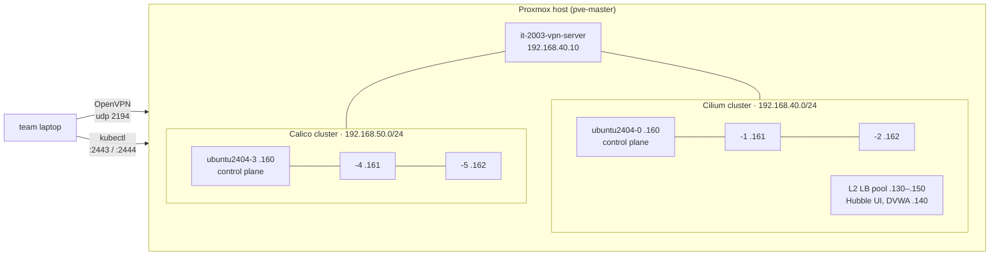

# Cilium eBPF và iptables trong mạng Kubernetes

**Cilium and eBPF-based Networking for Kubernetes: A Modern Alternative to Traditional iptables Networking**:
IT2003.11.CH course project (*Công nghệ Mạng và Truyền thông hiện đại*), Group 12.

**Goal:** measure, on real hardware, how far the theoretical differences between the two Kubernetes datapaths
show up in practice: Netfilter/iptables (Calico + kube-proxy) versus eBPF (Cilium with kube-proxy replacement).
Three experiments: Service latency at scale (E1), NetworkPolicy enforcement (E2), and diagnosing dropped
traffic (E3).

**Method:** two equivalent 3-node clusters on one Proxmox host, built with the same tooling (Terraform +
Kubespray v2.31.0, Kubernetes 1.35.8). Each experiment runs the same workload on both clusters. The full
report (in Vietnamese) is in `docs-latex/`; the slides for the talk are in `presentation/`.



E1 headline: from 100 to 10,000 Services, iptables p50 connection latency rose from **2.36 ms to 4.74 ms**
(110k nat rules), while Cilium stayed flat at **≈ 2.25 ms**. Details: [`e1/README.md`](e1/README.md).

## Experiments

| | question | status | where |
|---|---|---|---|
| **E1** | How does connection setup latency to a Service change as the number of Services grows? | done | `e1/` |
| **E2** | How is NetworkPolicy represented in the kernel by each datapath, and what happens when Pods are added? | in progress (DVWA target app) | `e2/` |
| **E3** | What does an operator need to find out why a connection was dropped (`iptables -L -v` vs Hubble)? | planned | n/a |

## Lab topology



- **Cilium:** eBPF datapath, `kubeProxyReplacement: true`, Hubble (relay + UI), L2 announcements for
  LoadBalancer IPs. Helm values: `kubernetes/network/cilium/production.yaml`.
- **Calico:** iptables datapath, kube-proxy in `iptables` mode (not Kubespray's default `ipvs`).
  Inventory: `infrastructure/configuration/inventory/calico/`.
- **Pod routing:** both clusters use direct routing, no overlay (Calico: BIRD BGP with IPIP/VXLAN off;
  Cilium: native routing with `autoDirectNodeRoutes`), so MTU stays 1500 and the comparison isolates
  Service and policy handling.

## Quick start

```bash
git submodule update --init                # kubespray, microservices-demo, docs-latex
python3 -m venv e1/.venv && e1/.venv/bin/pip install -r e1/requirements.txt   # E1 scripts
```

With `kubectl` contexts for both clusters (API through Proxmox DNAT: `:2443` Cilium, `:2444` Calico):

```bash
cd e1
.venv/bin/python scripts/main.py           # interactive: pick cluster, quick test / full run / demo / charts
.venv/bin/python scripts/run-e1.py run iptables   # or without prompts: Setup A (context it2003@calico)
.venv/bin/python scripts/run-e1.py run cilium     #                     Setup B (context it2003@cilium)
.venv/bin/python scripts/collect-and-draw-chart.py results/e1.csv

kubectl apply -f e2/manifests/dvwa.yaml    # E2 target app on the Cilium cluster (LB 192.168.40.140)
```

Knobs, quick-test mode and how to read the numbers: [`e1/README.md`](e1/README.md).

Rebuilding the infrastructure from scratch:

1. `infrastructure/tf/`: `terraform apply` creates the SDN subnets, the 6 VMs and the VPN VM
   (needs `proxmox_endpoint`, `proxmox_username`, `proxmox_password`, `it2003_vpn_password`).
2. `infrastructure/configuration/`: Ansible playbooks for users and swap, the Proxmox firewall/DNAT
   (`proxmox-firewall-*.yaml`), then Kubespray with the inventory for each cluster.
3. Cilium: `helm install` from `kubernetes/network/cilium/` with `production.yaml`, then
   `kubectl apply -f kubernetes/network/cilium-config/l2.yaml`.
4. Optional: observability charts in `kubernetes/observibility/`, Online Boutique from `microservices-demo/`.

## Presentation

Slidev deck condensed from the report (slide text in Vietnamese, diagram labels in English), with a
"LIVE DEMO" cue slide for each experiment:

```bash
cd presentation
npm install
npm run dev        # http://localhost:3030, press P for presenter mode
npm run export     # PDF (uses playwright-chromium)
```

`slides.md` holds the deck; the diagrams (topology, K8s model, packet paths, Service lookup, ...) are
SVG/Vue components in `presentation/components/`. Slidev is pinned to 52.20.1 because 53+ needs
Node ≥ 22.12; `.npmrc` (`legacy-peer-deps`) and the `markdown-it` override in `package.json` work around
npm peer-dependency errors. Keep them unless Node is upgraded.

## Repository layout

| path | what it is |
|---|---|
| `infrastructure/tf/` | Terraform (bpg/proxmox): SDN subnets, cluster VMs, VPN server |
| `infrastructure/configuration/` | Ansible: users, swap, Proxmox firewall/DNAT, Kubespray inventory; `kubespray/` submodule |
| `infrastructure/e1-deployment-*.html` | E1 deployment diagrams |
| `kubernetes/network/` | Cilium Helm chart + values, L2 LB IP pool / announcement policy |
| `kubernetes/observibility/` | kube-prometheus-stack, Loki, Alloy (metrics + logs, Cilium metrics on) |
| `e1/` | E1: bench manifest, run/measure/plot scripts, results (CSV, PNG, raw fortio + rule dumps) |
| `e2/` | E2: manifests (DVWA) |
| `docs-latex/` | git submodule: LaTeX project report |
| `presentation/` | Slidev slides for the talk (`slides.md`, diagram components in `components/`) |
| `.agents/skills/slidev/` | Slidev agent skill for AI coding assistants (`npx skills add slidevjs/slidev`) |
| `microservices-demo/` | git submodule: [Google Online Boutique](https://github.com/GoogleCloudPlatform/microservices-demo), used as a realistic workload |
| `e1/requirements.txt` | Python dependencies for the E1 scripts (use `e1/.venv`) |

## Requirements

- Proxmox VE host with SDN, about 6 VMs × 4 vCPU.
- Terraform with the [bpg/proxmox](https://registry.terraform.io/providers/bpg/proxmox) provider, Ansible.
- `kubectl`, `helm`, `bash`, Python 3 (matplotlib) on the machine you run experiments from.
- Node.js ≥ 20.12 and npm for the slides.

## Safety

DVWA (`e2/manifests/dvwa.yaml`) is a deliberately vulnerable app with hard-coded credentials. Expose it only
on the lab LoadBalancer IP behind the VPN, never on the internet.

## References

- Cilium documentation: <https://docs.cilium.io>; Hubble: <https://github.com/cilium/hubble>.
- Kubespray: <https://github.com/kubernetes-sigs/kubespray>.
- Kubernetes networking model: <https://kubernetes.io/docs/concepts/services-networking/>.
- The full bibliography is in `docs-latex/ref.bib`.

## License

MIT, see `LICENSE`.
