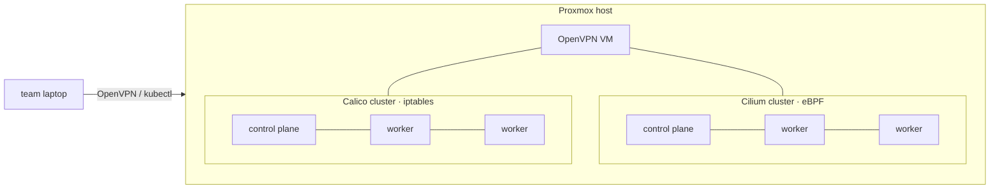

# Cilium eBPF vs iptables in Kubernetes networking

**Cilium and eBPF-based Networking for Kubernetes: A Modern Alternative to Traditional iptables Networking**:
IT2003.11.CH course project (*Công nghệ Mạng và Truyền thông hiện đại*), Group 12, lecturer PGS TS. Lê Trung Quân,
Semester I 2026–2027.

> **Status: closed (2026-10-31).** The course project is finished and the lab is torn down: the Proxmox
> VMs, VPN server and SDN subnets were destroyed with `terraform destroy`, and the DNAT rules and VPN route
> on the Proxmox host were removed. The Kubernetes contexts (`:2443`, `:2444`), the OpenVPN endpoint and the
> DVWA LB IP no longer exist. Code, results, report and slides stay here for reference.

Full report (Vietnamese, 31 pages): **[IT2003-Group12-Report.pdf](IT2003-Group12-Report.pdf)**.

## 1. Why this project

Most production Kubernetes clusters still run kube-proxy in iptables mode with a Netfilter-based CNI such as
Calico. Cilium with eBPF is now the common alternative, and the case for it is usually made with vendor
benchmarks. We picked this topic because it is a decision platform teams actually face, and we wanted our own
evidence for it:

- **Scale:** does Service routing get slower as a cluster grows to thousands of Services, and by how much?
- **Segmentation:** can both datapaths stop lateral movement and data exfiltration from a compromised Pod, and
  how hard is it to prove that a connection was dropped by a policy?
- **Runtime visibility:** what can you see inside a compromised Pod (processes, file reads, outbound
  connections), which a packet firewall cannot?
- **Outcome:** measured results on identical hardware, turned into a practical CNI recommendation instead of a
  feature list.

## 2. Lab environment

One Proxmox VE host in a homelab, built entirely as code, so both clusters come from the same tooling:

| layer | tool | what it does |
|---|---|---|
| VMs and networks | Terraform ([bpg/proxmox](https://registry.terraform.io/providers/bpg/proxmox)), [`infrastructure/tf/`](infrastructure/tf/) | SDN zones/subnets, 6 cluster VMs + 1 OpenVPN VM, per-VM Proxmox firewall |
| OS and host access | Ansible, [`infrastructure/configuration/`](infrastructure/configuration/) | users, swap off, DNAT on the Proxmox host for SSH / API / VPN |
| Kubernetes | Kubespray v2.31.0 | Kubernetes 1.35 on both clusters |
| CNI | Helm (Cilium 1.20.1), Kubespray (Calico) | the only layer that differs between the clusters |

Two clusters run side by side, each with 3 identical VMs (4 vCPU, 4 GiB RAM, 120 GB disk) on the same physical host,
so both datapaths are measured under the same conditions and can be demoed at the same time:

| | Calico cluster (192.168.50.0/24) | Cilium cluster (192.168.40.0/24) |
|---|---|---|
| Datapath | iptables | eBPF |
| Service handling | kube-proxy in `iptables` mode | kube-proxy replacement (no kube-proxy) |
| Pod routing | BGP (BIRD), no IPIP/VXLAN | native routing, `autoDirectNodeRoutes` |
| Extras | none | Hubble (flow logs + UI), Tetragon, L2 LoadBalancer IPs |

Both clusters use **direct routing with no overlay** (MTU 1500), so the results reflect Service and policy handling, not
encapsulation. Both also ran the same background load (kube-prometheus-stack, Loki, Alloy, Online Boutique, DVWA).
The team reached the clusters through OpenVPN and DNAT on the Proxmox host.

## 3. Experiments

### 3.1 E1: Service load balancing at scale, and infrastructure

*Owner: Ngô Vũ Minh Đạt (also built and ran the lab infrastructure above).*

**What we measured:** latency of a new TCP connection to a ClusterIP while the cluster grows from 100 to 10,000
Services. We used fortio at 200 req/s with no keep-alive, 3 runs for each of 6 Service counts, on both clusters
(36 runs, 216,000 requests, all successful).

| Services | iptables nat rules | Cilium LB-map entries | p50 iptables | p50 Cilium | p99 iptables | p99 Cilium |
|---:|---:|---:|---:|---:|---:|---:|
| 100 | 1,303 | 664 | 2.33 ms | 2.48 ms | 4.28 ms | 6.59 ms |
| 4,060 | 44,863 | 20,464 | 3.31 ms | 2.36 ms | 6.08 ms | 5.03 ms |
| 10,000 | 110,203 | 50,164 | 4.93 ms | 2.37 ms | 9.93 ms | 4.96 ms |

**Takeaways**
- **Cilium stays flat.** p50 stayed between 2.35 and 2.55 ms across the whole range.
- **iptables grows linearly.** p50 rose from 2.33 to 4.93 ms (+112 %, about +0.26 ms per 1,000 Services). At 10,000
  Services every new connection pays about 2.6 ms extra, 2.08× slower than Cilium.
- **The extra cost is in connection setup.** iptables `connect()` time rose from 1.10 to 3.30 ms, while Cilium's stayed
  at about 1.1 ms. So workloads that open many short connections pay the most. (We only measured new
  connections.)
- **Small clusters see no win.** At 100 Services iptables p50 is slightly lower (2.33 vs 2.48 ms), and below about
  3,000 Services its p99 is shorter. eBPF's advantage here is scalability, not raw speed.

**Limits:** one load level only; CPU usage, maximum throughput and rule-update time were not measured. Tetragon was
paused during the runs because it alone used about 1.9 CPU cores on the server node, so it adds a cost of its own.
Details: [`e1/README.md`](e1/README.md).

### 3.2 E2: NetworkPolicy segmentation, and E3: runtime security

*Owners: Nguyễn Hoài Phương and Nguyễn Long Vũ (shared).*

**E2: NetworkPolicy.** We segmented Google Online Boutique with a default-deny policy plus one allow policy per service,
and locked down DVWA (a deliberately vulnerable app, exposed only inside the lab behind the VPN). Each scenario ran on
both clusters:

| scenario | Cilium (eBPF) | Calico (iptables) |
|---|---|---|
| Compromised frontend calls Redis / Payment directly | blocked: SYN dropped, `Policy denied` with source/destination identity | blocked: `nc` timed out; matching `knp.default.<policy>` rules found in `iptables-save` |
| Reverse shell from DVWA to an outside listener | blocked: Hubble shows the egress flow denied | blocked: listener got nothing; `tcpdump` shows SYN retransmits with no SYN-ACK |
| Block one HTTP API path (L7) on DVWA | blocked: `Access denied`; Hubble logs the dropped `GET` with its path | not possible: standard and Calico OSS policies cannot inspect HTTP |

What matters for operations is how you **prove** a drop. On Cilium one tool, run through `kubectl` (Hubble or
`cilium-dbg monitor`), shows the flow, the identities and the reason. On Calico you need SSH to the node and two
separate tools (`tcpdump` plus `iptables-save`), although the rule names do point to the exact policy.
**Not done:** full coverage of the allowed flows (e.g. a complete checkout), other HTTP methods, and kernel-state
snapshots (BPF policy maps / ipsets) before and after scaling a Pod. Policies and scenarios:
[`e2/cilium/`](e2/cilium/README.md), [`e2/`](e2/).

**E3: runtime security with Tetragon** (Cilium cluster only; iptables has no equivalent). After exploiting DVWA,
monitor-only Tetragon policies recorded:

| event type | what it showed |
|---|---|
| process | `/bin/sh` and `ping` started by Command Injection, with full command line and exit codes |
| TCP connect | Apache connecting to MySQL (`127.0.0.1:3306`) and to the Kubernetes API (`:6443`) |
| file read | Apache reading the Pod's ServiceAccount token and `ca.crt` |

The useful lesson: when the attack runs inside the existing web process (a PHP file via File Inclusion), no new process
appears. Process logs alone miss it, and you need file and connect hooks to see the token theft and the API call.
**Not done:** overhead and event loss under load, and enforcement (all policies only log). Policies and PoC:
[`e3/Tetragon/`](e3/Tetragon/README.md).
