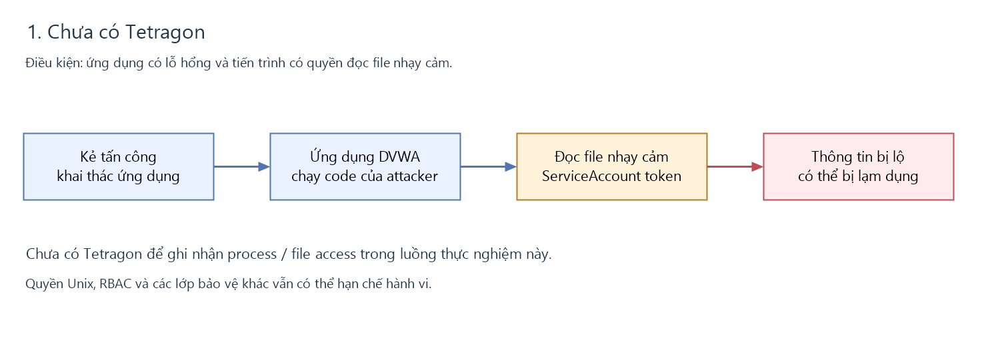
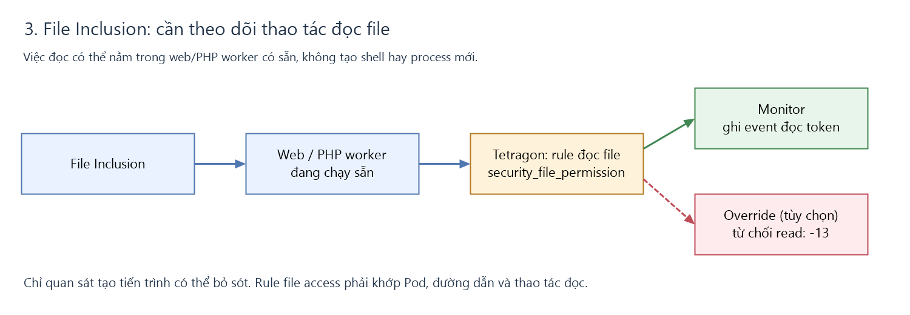

# Tetragon: kiểm soát hành vi sau khi ứng dụng bị khai thác

**Mục tiêu demo:** sau khi DVWA bị khai thác, kẻ tấn công đọc ServiceAccount token
của Pod. Cho thấy giám sát theo tiến trình **bỏ sót** luồng File Inclusion, và vì sao
cần rule theo **đường dẫn file** (hook `security_file_permission`).

## Điểm mấu chốt

- **Command Injection** tạo tiến trình mới (`sh`/`cat`/`curl`) → giám sát theo exec bắt được.
- **File Inclusion (LFI)** đọc token **ngay trong PHP worker có sẵn**, không sinh tiến trình
  mới → giám sát theo tiến trình bỏ sót. Với app PHP, việc đọc do PHP worker thực hiện,
  không phải nginx → phải kiểm soát theo **thao tác đọc file**, không theo tên tiến trình.




## Demo

```bash
# 1. Upload PoC qua trang File Upload của DVWA → hackable/uploads/expoilt.php
# 2. Kích hoạt qua File Inclusion (LFI): ?page=../../hackable/uploads/expoilt.php
#    → đọc token NGAY trong PHP worker, không sinh tiến trình mới

# 3. Rule giám sát đọc file token (hook security_file_permission)
kubectl apply -f dvwa-token-monitor.yaml
kubectl exec -n kube-system ds/tetragon -c tetragon -- \
  tetra getevents -o compact        # sự kiện đọc .../serviceaccount/token
```

Nhánh xanh trong hình là ghi nhận sự kiện; nhánh đỏ nét đứt là enforcement tuỳ chọn
(cần rule và runtime hỗ trợ). Hình minh hoạ luồng xử lý, không phải kết quả chặn đã xác minh.

## File trong thư mục

| File | Tác dụng |
|---|---|
| [dvwa-token-monitor.yaml](dvwa-token-monitor.yaml) | Bản hiện có: ghi nhận thao tác đọc file, chưa chặn |
| [examples/dvwa-token-monitor-scoped.yaml](examples/dvwa-token-monitor-scoped.yaml) | Mẫu theo dõi đọc token riêng cho Pod DVWA |
| [examples/dvwa-token-enforce.yaml](examples/dvwa-token-enforce.yaml) | Mẫu từ chối đọc token bằng `Override -13`, cần kernel hỗ trợ và kiểm thử trước |
| [expoilt.php](expoilt.php) | PoC đọc token, kiểm tra danh tính & quyền Kubernetes API |

**Trạng thái:** các policy đang ở `monitor_only`; chưa có bằng chứng Command Injection
hoặc đọc token đã bị Tetragon chặn. Hai mẫu trong `examples/` chưa được triển khai.
