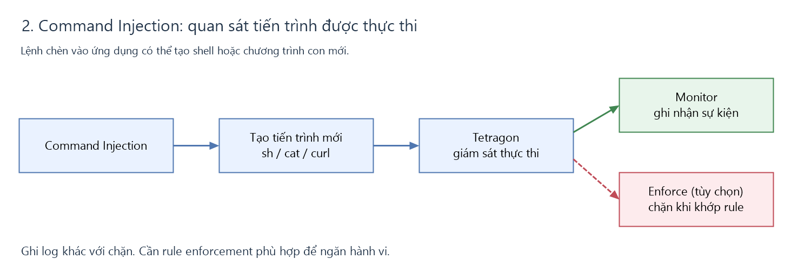

# Tetragon: kiểm soát hành vi sau khi ứng dụng bị khai thác

## 1. Khi chưa có Tetragon

Nếu ứng dụng có lỗ hổng và tiến trình ứng dụng có quyền đọc file, kẻ tấn công có thể đọc thông tin nhạy cảm như ServiceAccount token. Khi chưa có giám sát runtime, hành vi này khó được phát hiện hơn.

## 2. Command Injection

Kẻ tấn công lợi dụng ứng dụng để chạy lệnh, ví dụ tạo tiến trình `sh`, `cat` hoặc `curl`.

Tetragon có thể ghi nhận tiến trình được thực thi. Muốn chặn, cần thêm rule enforcement phù hợp; chỉ có log chưa có nghĩa lệnh đã bị chặn.

## 3. File Inclusion

Kẻ tấn công lợi dụng chức năng include/đọc file của ứng dụng. Việc đọc có thể diễn ra ngay trong tiến trình web/PHP đang chạy sẵn, không tạo shell hay tiến trình mới.

Không nên mặc định mọi lần đọc đều do nginx: với ứng dụng PHP, việc đọc thường do PHP worker hoặc tiến trình web chạy PHP thực hiện.

Vì vậy cần **rule kiểm soát đọc file**, thay vì chỉ kiểm tra tên tiến trình:

Ví dụ theo dõi việc đọc ServiceAccount token qua hook `security_file_permission`. Rule cần chọn đúng namespace/Pod, đường dẫn file và thao tác đọc.

Trong các hình, nhánh xanh là ghi nhận sự kiện; nhánh đỏ nét đứt là enforcement tùy chọn, cần rule và hỗ trợ runtime phù hợp. Các hình minh họa luồng xử lý, không phải kết quả chặn đã được xác minh trên cluster.

## 4. Các rule trong thư mục này

| File | Tác dụng |
|---|---|
| [dvwa-token-monitor.yaml](dvwa-token-monitor.yaml) | Bản hiện có: ghi nhận thao tác đọc file, chưa chặn |
| [examples/dvwa-token-monitor-scoped.yaml](examples/dvwa-token-monitor-scoped.yaml) | Mẫu theo dõi đọc token riêng cho Pod DVWA |
| [examples/dvwa-token-enforce.yaml](examples/dvwa-token-enforce.yaml) | Mẫu từ chối đọc token bằng `Override -13`, cần kernel hỗ trợ và kiểm thử trước |
| [expoilt.php](expoilt.php) | PoC đọc token, kiểm tra danh tính và quyền Kubernetes API |

**Trạng thái đã kiểm tra:** các policy hiện có đang ở `monitor_only`. Chưa có bằng chứng Command Injection hoặc đọc token đã bị Tetragon chặn. Hai mẫu trong `examples/` chưa được triển khai.
