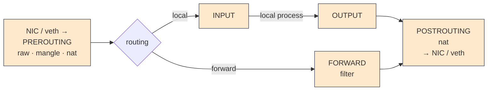
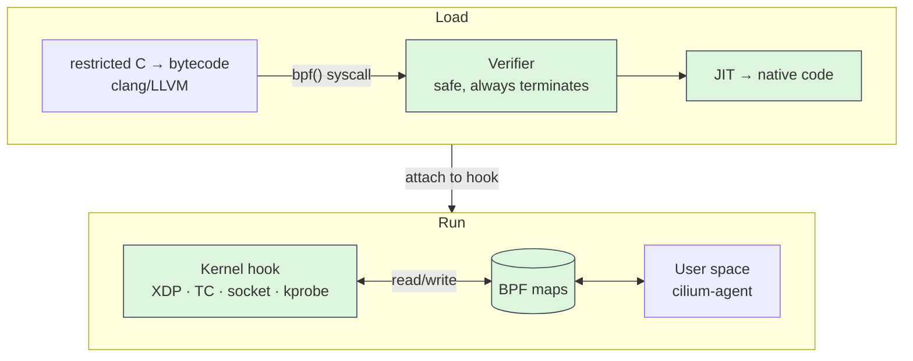
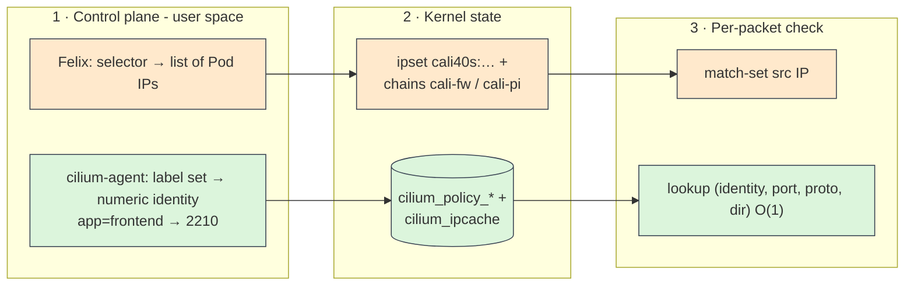
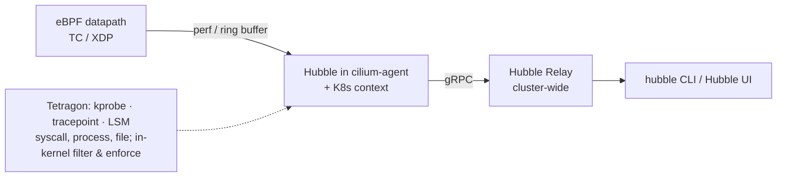

<div class="flex items-center gap-4 mb-6">
  
  <div class="text-sm leading-tight muted">
    ĐẠI HỌC QUỐC GIA TP.HCM<br/>TRƯỜNG ĐẠI HỌC CÔNG NGHỆ THÔNG TIN
  </div>
</div>

<h1 v-motion :initial="{ x: -60, opacity: 0 }" :enter="{ x: 0, opacity: 1, transition: { duration: 700 } }" style="font-size:2.1rem;line-height:1.2;color:#14532d">Cilium and eBPF-based Networking for Kubernetes</h1>

<div v-motion :initial="{ x: -60, opacity: 0 }" :enter="{ x: 0, opacity: 1, transition: { duration: 700, delay: 250 } }" class="text-xl mt-1 mb-6">A Modern Alternative to Traditional iptables Networking</div>

<div v-motion :initial="{ y: 30, opacity: 0 }" :enter="{ y: 0, opacity: 1, transition: { duration: 700, delay: 550 } }" class="grid grid-cols-2 gap-6 text-sm">
<div>

**Môn học:** Công nghệ Mạng và Truyền thông hiện đại<br/>
**Mã lớp:** IT2003.11.CH · **GV:** Lê Trung Quân<br/>
Học kì II, 2025–2026

</div>
<div>

**Nhóm 12**<br/>
250202052 – Nguyễn Hoài Phương<br/>
250202060 – Nguyễn Long Vũ<br/>
26848033 – Ngô Vũ Minh Đạt

</div>
</div>

---

# Nội dung

<div class="grid grid-cols-2 gap-8 mt-4">
<div v-motion :initial="{ x: -40, opacity: 0 }" :enter="{ x: 0, opacity: 1, transition: { duration: 600 } }">

1. **Bối cảnh & phạm vi đồ án**
2. **Cơ sở lý thuyết**
   - Mô hình mạng K8s, primitive của Linux
   - Netfilter/iptables và eBPF
   - Đường đi gói tin
3. **Hạ tầng thực nghiệm**

</div>
<div v-motion :initial="{ x: 40, opacity: 0 }" :enter="{ x: 0, opacity: 1, transition: { duration: 600, delay: 200 } }">

4. **E1** – Hiệu năng Service theo quy mô · <span class="demo-badge">DEMO</span>
5. **E2** – Thực thi NetworkPolicy · <span class="demo-badge">DEMO</span>
6. **E3** – Chẩn đoán gói tin bị drop · <span class="demo-badge">DEMO</span>
7. **Ma trận quyết định & kết luận**

</div>
</div>

---

# Bối cảnh: giới hạn của iptables ở quy mô cloud-native

Kubernetes giao mạng cho **CNI** (IP, routing, NetworkPolicy) và **kube-proxy** (ClusterIP của Service). Cả hai truyền thống đều dựa trên **Netfilter/iptables**, vốn được thiết kế cho tập luật tường lửa tĩnh.

<v-clicks>

| Vấn đề | Nguyên nhân |
|---|---|
| **Độ phức tạp tuyến tính** | Gói đầu tiên của mỗi kết nối so khớp tuần tự chuỗi luật Service → $O(n)$ |
| **Cập nhật nguyên khối** | Đổi 1 Service → ghi lại bảng luật qua `iptables-restore` |
| **Tranh chấp conntrack** | Bảng `nf_conntrack` dùng chung → nghẽn khi tạo kết nối mới nhanh |
| **Chính sách gắn với IP** | NetworkPolicy → tập IP; IP Pod tạm thời → đồng bộ lại trên mọi node |
| **Quan sát kém** | Drop chỉ tăng bộ đếm luật, không biết Pod/chính sách nào |

</v-clicks>

---

# Giải pháp hiện có & phạm vi đồ án

<div class="small muted">

Các hướng cải thiện đã có: kube-proxy **IPVS** / **nftables**, **Calico eBPF** dataplane, **Cilium**…

</div>

<div v-click class="mt-10 text-center text-lg">

**Đồ án tập trung vào hai datapath cốt lõi**, qua hai CNI phổ biến nhất:

<div class="flex items-stretch justify-center gap-10 mt-8">
  <div class="card ipt text-center w-80 !py-6">
    <div class="text-4xl font-bold">iptables</div>
    <div class="small muted">Netfilter · kube-proxy</div>
    <div class="mt-3 text-2xl font-bold">Calico</div>
  </div>
  <div class="self-center text-3xl font-bold muted">vs</div>
  <div class="card ebpf text-center w-80 !py-6">
    <div class="text-4xl font-bold">eBPF</div>
    <div class="small muted">kube-proxy replacement</div>
    <div class="mt-3 text-2xl font-bold">Cilium</div>
  </div>
</div>

</div>


---
layout: section
transition: slide-up | slide-down
---

# Cơ sở lý thuyết

---

# Mô hình mạng Kubernetes

<K8sModel />

<div class="grid grid-cols-3 gap-3 small mt-1 text-center">
  <div class="card neutral !py-1">① Pod ↔ Pod mọi node, <b>không NAT</b></div>
  <div class="card neutral !py-1">② Node ↔ mọi Pod trên node</div>
  <div class="card neutral !py-1">③ IP Pod tự thấy = IP người khác thấy</div>
</div>

<div v-click="3" class="small text-center mt-2">

**Service**: ClusterIP ảo **không gắn interface**, chỉ là luật **DNAT** trên mỗi node (kube-proxy / eBPF)

</div>

---

# Primitive mạng của Linux & CNI

<LinuxPrimitives />

<div class="small muted text-center mt-2">

*netns · pause container · veth · CNI: chi tiết từng thành phần xem trong báo cáo*

</div>

---

# Netfilter / iptables & conntrack



<v-clicks>

- 5 hook, luật tổ chức thành **bảng** (`filter`, `nat`, `mangle`, `raw`) và **chuỗi**. Mỗi chuỗi là **danh sách duyệt tuần tự** đến target kết thúc (`ACCEPT`, `DROP`, `DNAT`…)
- **conntrack**: chỉ **gói đầu tiên** duyệt bảng `nat`; quyết định NAT được lưu cho các gói sau
- → Chi phí iptables tập trung ở <span class="hl">**thiết lập kết nối**</span> → E1 đo **kết nối mới cho mỗi request**

</v-clicks>

---

# eBPF: máy ảo an toàn trong nhân Linux



<div class="cmp small" v-click>
<div>

- **XDP**: trong driver NIC, trước `sk_buff`, sớm nhất (LB North-South)
- **TC ingress/egress**: mọi interface kể cả veth → Cilium dùng cho routing, NAT, policy
- **cgroup/socket** (`connect4`, `sendmsg4`): dịch địa chỉ Service ngay tại `connect()`

</div>
<div>

- **sock_ops / sk_msg** (sockmap): nối thẳng 2 socket cùng host
- **kprobe, tracepoint, LSM**: quan sát & bảo mật runtime (Tetragon)

</div>
</div>

---

# BPF map & datapath của Cilium

<div class="cmp">
<div class="small">

### BPF map
- Chương trình eBPF **không giữ trạng thái**; trạng thái nằm trong **map** key-value trong nhân, đọc/ghi từ cả eBPF và user space
- Loại: hash, **LRU hash**, array, **LPM trie** (CIDR), per-CPU, ring buffer / perf (đẩy sự kiện)
- Cập nhật **nguyên tử từng phần tử** → không cần nạp lại chương trình
- Kích thước cố định khi tạo → định cỡ theo quy mô cụm

</div>
<div class="small" v-click>

### Cilium trên mỗi node
**cilium-agent** theo dõi API server, nạp eBPF vào `lxc*`, NIC, `cilium_host`, `cilium_vxlan`.

| Map | Vai trò |
|---|---|
| `cilium_lb4_services_v2` / `backends_v3` | Service & backend |
| `cilium_ct4_global` | conntrack riêng |
| `cilium_ipcache` | IP → security identity |
| `cilium_policy_*` | chính sách từng endpoint |

</div>
</div>

---

# Đường đi gói tin: intra-pod & intra-node

<div class="small mb-2">

**Intra-pod:** các container chung netns → chung IP & không gian cổng, nói chuyện qua `localhost` (vẫn qua toàn bộ TCP/IP stack; sockmap có thể bỏ qua).
**Intra-node:** iptables đi qua bridge/route /32, toàn bộ Netfilter của host; Cilium **redirect thẳng** sang veth Pod đích (BPF host routing, nhân ≥ 5.10).

</div>

<div class="mt-4">
<PathCompare />
</div>

---

# Đường đi gói tin: inter-node (direct routing)

<DirectRouting />

<div v-click class="grid grid-cols-2 gap-4 small mt-2">
  <div class="card ipt !py-2"><b>Calico</b>: BIRD quảng bá podCIDR của node qua <b>BGP</b></div>
  <div class="card ebpf !py-2"><b>Cilium</b>: <code>autoDirectNodeRoutes</code> cài route trực tiếp (cùng L2)</div>
</div>

---

# Cân bằng tải Service: kube-proxy iptables (E1)

```text {1|2-3|4-5}
-A KUBE-SERVICES -d 10.233.12.34/32 -p tcp --dport 80 -j KUBE-SVC-ABCD
-A KUBE-SVC-ABCD -m statistic --mode random --probability 0.5 -j KUBE-SEP-1111
-A KUBE-SVC-ABCD -j KUBE-SEP-2222
-A KUBE-SEP-1111 -p tcp -j DNAT --to-destination 10.244.1.20:8080
-A KUBE-SEP-2222 -p tcp -j DNAT --to-destination 10.244.2.21:8080
```

<div class="cmp small mt-3">
<div v-click>

- `KUBE-SERVICES`: **1 luật / (ClusterIP, port)**, gọi từ `PREROUTING` & `OUTPUT`
- `KUBE-SVC-*`: chọn backend ngẫu nhiên (`statistic`, 1/n, 1/(n-1)…)
- `KUBE-SEP-*`: **DNAT** tới Pod backend

</div>
<div v-click>

- **Tra cứu $O(n)$**: SYN có thể duyệt hàng nghìn luật → lộ rõ với TCP_CRR
- **Cập nhật**: `iptables-restore` giữ khoá xtables, chậm theo kích thước bảng (partial sync từ 1.27)
- **conntrack** chung: tranh chấp khoá, giới hạn `nf_conntrack_max`

</div>
</div>

---

# Cilium kube-proxy replacement (KPR)

<div class="cmp small">
<div>

- Service/backend trong **BPF hash map** → tra cứu theo (VIP, port, proto) **$O(1)$**
- **Socket-level LB**: hook `connect()` dịch ClusterIP → backend ngay ở socket, không NAT từng gói
- NodePort/LoadBalancer: xử lý tại **TC / XDP**

</div>
<div>

- **Cập nhật gia tăng**: chỉ ghi phần tử thay đổi, nguyên tử
- **conntrack riêng**: `cilium_ct4_global` (BPF LRU) thay `nf_conntrack`

</div>
</div>

<div class="mt-6" v-click>
<LookupCompare />
</div>

---
layout: section
transition: slide-up | slide-down
---

# Hạ tầng thực nghiệm

---
clicks: 5
---

# Topology homelab

<div class="tiny muted -mt-3 mb-1">Terraform (bpg/proxmox) · Ansible · Kubespray · Cilium bằng Helm. Hai cụm 3 node song song, VM giống hệt nhau (4 vCPU, 4 GiB, 120 GB, Ubuntu 24.04, nhân 6.8).</div>

<Topology />

---

# Cấu hình hai cụm: chỉ khác lớp mạng

| Thành phần | Cụm Calico (192.168.50.0/24) | Cụm Cilium (192.168.40.0/24) |
|---|---|---|
| **CNI** | Calico (Kubespray), iptables dataplane | Cilium 1.20.1 (Helm) |
| **Service datapath** | kube-proxy, `kube_proxy_mode: iptables` | `kubeProxyReplacement: true` (không kube-proxy) |
| **Định tuyến Pod** | Direct routing, BGP (BIRD) | Direct routing, `autoDirectNodeRoutes` |
| **Masquerade** | iptables | eBPF (`bpf.masquerade`) |
| **Pod CIDR** | 10.244.0.0/16, khối /26 | 10.244.0.0/16, /24 mỗi node |
| **LoadBalancer** | – | LB-IPAM + L2 announcement, .40.130–150 |
| **Quan sát** | – | Hubble, Relay, UI (192.168.40.132) |
| **Kubernetes / nhân** | v1.35.8 · 6.8.0-142 | v1.35.7–8 · 6.8.0-142 |

<div class="small mt-3" v-click>

Cả hai dùng **direct routing**, MTU 1500 → khác biệt đo được phản ánh **cách xử lý Service & chính sách**, không phải chi phí đóng gói.
Truy cập: OpenVPN (10.8.0.0/24) để vào IP L2 nội bộ khi demo; SSH/`kubectl` qua cổng forward (`:2443` Cilium, `:2444` Calico).

</div>

---
layout: section
transition: slide-up | slide-down
---

# E1 – Hiệu năng Service theo quy mô

---

# E1: thiết lập đo

<div class="cmp small">
<div>

### Giả thuyết
iptables duyệt `KUBE-SERVICES` tuần tự → độ trễ **tăng theo N**; Cilium tra hash map → **không đổi**.

### Tải nền
- $N \in \{100;\ 2080;\ 4060;\ 6040;\ 8020;\ 10000\}$ Service giả
- Mỗi Service → 3 Pod `pause` → ~**11 luật nat** (iptables) / ~**5 dòng** LB map (Cilium)

</div>
<div v-click>

### Đo
- **fortio 1.75.3**, client & server trên 2 worker khác nhau, gọi **ClusterIP** với `-keepalive=false` (mỗi request 1 kết nối TCP mới)
- 200 req/s · 4 kết nối · 30 s · warm-up 5 s
- Chờ EndpointSlice + số luật ổn định + 20 s rồi mới đo
- 3 lần / N → **36 lần chạy**, kích thước bảng đọc trên node client (`iptables-save -t nat`, `cilium-dbg bpf lb list`)
- Tải nền giống nhau trên 2 cụm (Prometheus, Loki, Alloy, metrics-server); Tetragon tạm dừng khi đo

</div>
</div>

---

# E1: kết quả


<div v-click>

| N Service | Bảng iptables | Bảng Cilium | p50 iptables (ms) | p50 Cilium (ms) | p99 ipt / cil (ms) | p50 ipt/cil |
|---:|---:|---:|---:|---:|---:|---:|
| 100 | 1 303 | 664 | 2.33 | 2.48 | 4.28 / 6.59 | 0.94 |
| 4 060 | 44 863 | 20 464 | 3.31 | 2.36 | 6.08 / 5.03 | 1.40 |
| 10 000 | 110 203 | 50 164 | **4.93** | **2.37** | 9.93 / 4.96 | <span v-mark.circle.red="2">**2.08**</span> |

</div>

---

# E1: toàn bộ phân phối độ trễ


<div v-click class="text-center mt-2">

<span class="hl">iptables: cả đường dịch phải (+2.6 ms ở trung vị); Cilium: hai đường trùng nhau</span>

</div>

---

# E1: nhận xét & đánh giá

<div class="cmp small">
<div>
<v-clicks>

- **Cilium phẳng**: p50 2.48 → 2.37 ms (100 → 10 000 Service), độ dốc ≈ −0.016 ms / 1 000 Service, trong biên dao động
- **iptables tuyến tính** ($r = 0.999$): +0.26 ms / 1 000 Service; p50 tăng **+112%**; ở 10 000 Service **chậm 2.08×**, +2.56 ms mỗi kết nối mới
- **Cách tra cứu quyết định, không phải kích thước bảng**: Cilium 50 164 entry → 2.37 ms; iptables 44 863 luật → 3.31 ms
- **p99**: iptables đuôi ngắn hơn ở quy mô nhỏ, hai đường **cắt nhau ≈ 3 000 Service**
- 216 000 request, **0 lỗi**: khác biệt chỉ ở độ trễ

</v-clicks>
</div>
<div class="card ebpf" v-click>

### Kết luận E1
Kết quả **ủng hộ giả thuyết**: chi phí Service của eBPF không đổi theo quy mô; iptables tăng tuyến tính, gấp đôi ở 10k Service.

<div class="tiny mt-2 muted">

**Giới hạn**: 3 lần/điểm; 1 mức tải; độ trễ gồm ~2.2 ms của app; chưa đo thời gian cập nhật luật; Cilium đo đường socket-LB (chưa đo TC per-packet); 2 cụm riêng (containerd/patch OS khác nhỏ), tải nền đã cân bằng, Tetragon tạm dừng khi đo.

</div>
</div>
</div>

---
layout: center
class: text-center
transition: fade
---

<span class="demo-badge" v-motion :initial="{ scale: 0.4, opacity: 0 }" :enter="{ scale: 1, opacity: 1, transition: { type: 'spring', stiffness: 260, damping: 14 } }">LIVE DEMO</span>

# E1 – Một Service trong iptables vs eBPF

<div class="text-left inline-block small mt-4">

```bash
# Một Service được biểu diễn thế nào trên node client
./e1/scripts/run-e1.py show iptables     # KUBE-SERVICES → KUBE-SVC → KUBE-SEP (DNAT)
./e1/scripts/run-e1.py show cilium       # frontend + backend trong LB map

# Kích thước datapath
iptables-save -t nat | wc -l              # cụm Calico
cilium-dbg bpf lb list | wc -l            # cụm Cilium

# Chạy nhanh 1 vòng đo
./e1/scripts/run-e1.py run cilium --quick
```

</div>

---
layout: section
transition: slide-up | slide-down
---

# E2 – Thực thi NetworkPolicy

---

# NetworkPolicy: iptables vs eBPF (E2)

Gói tin chỉ mang **IP**, không mang **label** → mọi hiện thực đều phải dịch *label → thứ kiểm tra được trên gói*:



<div class="small">
<v-clicks>

- **iptables**: chính sách **gắn với IP tạm thời** → Pod tạo/huỷ ⇒ Felix trên **mọi node** sửa ipset; trong lúc trễ: chặn nhầm Pod mới / cho phép nhầm IP tái sử dụng
- **eBPF**: Pod mới cùng label ⇒ identity **đã có**, **policy map giữ nguyên**, chỉ phân phối ipcache (hoặc identity đi trong VNI). Hỗ trợ **L7** qua Envoy (`CiliumNetworkPolicy`)

</v-clicks>
</div>

---

# So sánh cơ chế thực thi NetworkPolicy

| | **iptables (Calico)** | **eBPF (Cilium)** |
|---|---|---|
| **Đơn vị nhận diện** | Địa chỉ IP của Pod | Security identity (số) từ label |
| **Ai tạo ra (user space)** | Felix: selector → danh sách IP | cilium-agent: tập label → identity (`CiliumIdentity`) |
| **Cấu trúc trong nhân** | ipset + chuỗi `cali-*` | `cilium_policy_*`, `cilium_ipcache` |
| **Khi Pod mới xuất hiện** | <span v-mark.orange="1">Cập nhật ipset trên **mọi node**</span> | <span v-mark.green="2">Chỉ cập nhật ipcache; **policy map giữ nguyên**</span> |
| **Phạm vi** | L3/L4 | L3/L4 và **L7** (HTTP method/path qua Envoy) |
| **Công cụ kiểm tra** | `ipset list`, `iptables-save` | `cilium identity list`, `cilium bpf policy get` |

---
layout: center
class: text-center
transition: fade
---

<span class="demo-badge" v-motion :initial="{ scale: 0.4, opacity: 0 }" :enter="{ scale: 1, opacity: 1, transition: { type: 'spring', stiffness: 260, damping: 14 } }">LIVE DEMO</span>

# E2 – NetworkPolicy trong nhân

<div class="text-left inline-block small mt-4">

```bash
kubectl apply -f e2/manifests/dvwa.yaml       # ứng dụng mục tiêu (LB 192.168.40.140)

# iptables / Calico: label → IP
ipset list | grep -A5 cali40s                 # IP của Pod khớp selector
iptables-save | grep cali-pi                  # chuỗi chính sách

# eBPF / Cilium: label → identity
cilium identity list                          # tập label → identity số
cilium bpf policy get --all                   # policy map của endpoint

kubectl scale deploy/dvwa -n dvwa --replicas=3   # Pod mới: ipset đổi, policy map giữ nguyên?
```

</div>

---
layout: section
transition: slide-up | slide-down
---

# E3 – Chẩn đoán lưu lượng bị drop

---

# Quan sát & chẩn đoán lưu lượng bị drop (E3)

<div class="cmp small">
<div class="card ipt">

### iptables / Calico
- Gói dừng ở luật `DROP` → nhân chỉ tăng **bộ đếm packet/byte** (`iptables -L -n -v`)
- **Không** có Pod nguồn, namespace, label, tên policy
- `LOG`/`NFLOG`: phải sửa luật, tự map IP → Pod
- Thực tế: `calicoctl node diags` + đối chiếu thời gian với lịch sử cấp IP

</div>
<div class="card ebpf" v-click>

### Cilium Hubble
- Datapath phát sự kiện (forwarded, **dropped + lý do**, policy verdict) qua perf/ring buffer
- **Hubble** (trong agent) gắn ngữ cảnh K8s: Pod, ns, label, identity, Service
- `hubble observe --verdict DROPPED` → biết ngay *ai → ai, vì sao* (`Policy denied`)
- **Hubble UI**: service map, đánh dấu kết nối bị chặn, không cần sidecar

</div>
</div>

<div v-click>



</div>

---
layout: center
class: text-center
transition: fade
---

<span class="demo-badge" v-motion :initial="{ scale: 0.4, opacity: 0 }" :enter="{ scale: 1, opacity: 1, transition: { type: 'spring', stiffness: 260, damping: 14 } }">LIVE DEMO</span>

# E3 – Vì sao kết nối bị chặn?

<div class="text-left inline-block small mt-4">

```bash
# iptables / Calico: chỉ có bộ đếm
iptables -L -n -v | grep -i drop

# Cilium Hubble: luồng sự kiện có ngữ cảnh K8s
hubble observe --verdict DROPPED -n dvwa
hubble observe --to-pod dvwa/<pod> --verdict DROPPED -o compact
```

**Hubble UI:** `http://192.168.40.132` (qua OpenVPN)

</div>

---

# Ma trận quyết định kiến trúc

| Tiêu chí | iptables / Calico + kube-proxy | eBPF / Cilium |
|---|---|---|
| **Tra cứu Service** | Duyệt tuần tự chuỗi luật, $O(n)$ | BPF hash map, $O(1)$ — <span v-mark.green="1">**E1 xác nhận**</span> |
| **Cập nhật bảng Service** | Sinh lại & nạp qua `iptables-restore` | Ghi nguyên tử từng phần tử |
| **Đường đi trên host** | Netfilter + IP stack host + veth | Redirect trực tiếp tại TC/XDP |
| **Conntrack** | `nf_conntrack` dùng chung | BPF LRU map riêng |
| **Mô hình chính sách** | Label → tập IP trong ipset | Label → security identity |
| **Đồng bộ chính sách** | Sửa ipset mọi node khi IP đổi | Policy map độc lập IP; chỉ đồng bộ ipcache |
| **Phạm vi chính sách** | L3/L4 | L3/L4 + L7 (Envoy) |
| **Chẩn đoán drop** | Bộ đếm, không ngữ cảnh | Hubble: sự kiện có ngữ cảnh K8s |
| **Bảo mật runtime** | Không thấy syscall | Tetragon: theo dõi & enforce trong nhân |
| **Yêu cầu nhân** | Hầu hết mọi phiên bản | ≥ 5.4; ≥ 5.10 cho BPF host routing |
| **Vận hành** | Công cụ quen thuộc, tài liệu nhiều | Cần hiểu eBPF, `cilium`, `bpftool`, `hubble` |

---
layout: center
---

# Kết luận

<div class="small">
<v-clicks>

- Ở cụm nhỏ, phần cứng phổ thông, khác biệt lý thuyết **đo được rõ ràng**: với 10 000 Service, iptables chậm hơn **2.08×** mỗi kết nối mới, Cilium **không đổi**
- eBPF tách **chính sách khỏi IP** (identity) và đem lại **quan sát có ngữ cảnh** (Hubble) mà iptables không có
- Đổi lại: yêu cầu nhân mới hơn và đội vận hành phải học công cụ mới
- **Khuyến nghị**: cụm lớn / nhiều Service / cần chính sách L7 & quan sát → **Cilium eBPF**; cụm nhỏ, nhân cũ, ưu tiên quen thuộc → iptables vẫn chấp nhận được

</v-clicks>
</div>

<div v-click class="text-center mt-10 text-2xl font-bold" style="color:#14532d">Cảm ơn! Hỏi & Đáp</div>
